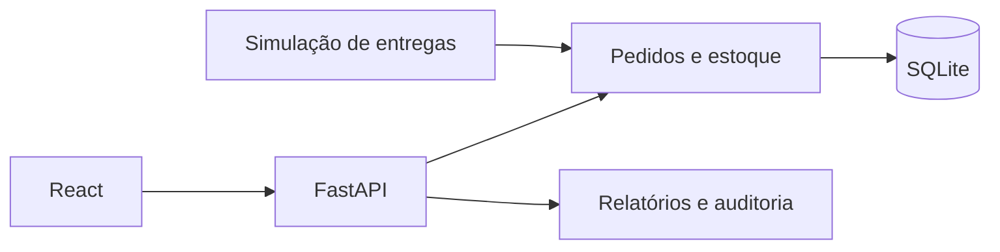

# NexoLog

## 1. Apresentação

Sistema demonstrativo de gestão logística que conecta pedidos, reservas, estoque, entregas e indicadores.

## 2. Problema empresarial

Acompanhar como pedidos e entregas alteram os saldos de estoque e o desempenho da operação.

## 3. Objetivo

Reunir cadastros, movimentações e estados dos pedidos em um fluxo com permissões e auditoria.

## 4. Funcionalidades implementadas

- Produtos, variantes, precificação e saldos.
- Pedidos e estados, reservas, expedição, cancelamento e devolução.
- Clientes, fornecedores e usuários com perfis.
- Rastreamento demonstrativo, relatórios CSV e auditoria.

As funcionalidades foram identificadas nos módulos e na documentação originais. Os resultados de verificação desta cópia estão em [Validação](docs/github/VALIDACAO.md); não se alegam ganhos de negócio ou métricas de produção.

## 5. Tecnologias

Python 3.13, FastAPI, Pydantic, SQLAlchemy, SQLite, React, JavaScript/JSX, Vite, React Router e Recharts. Ferramentas de distribuição Windows já estão no projeto.

Os manifests originais foram preservados. Nenhuma dependência nova foi adicionada à aplicação para esta apresentação.

## 6. Arquitetura



[Arquitetura e limites da cópia](docs/github/ARQUITETURA.md).

## 7. Estrutura de pastas

```text
backend/     API, modelos, regras e migrations locais
frontend/    interface React/JSX
data/        fixture demonstrativa e manifesto
tests/       testes de operação com banco temporário
scripts/     gerador, execução e ferramentas
desktop/     iniciador e empacotamento Windows
docs/        documentação existente
```

Ambientes instalados, caches, bancos operacionais, configurações privadas e compilados ficam fora do pacote fonte. [Critérios de seleção](docs/github/SEGURANCA.md).

## 8. Instalação

Na raiz da cópia, com Python 3.13 e Node.js compatível com Vite 8:

```powershell
py -3.13 -m venv .venv
.\.venv\Scripts\python.exe -m pip install -r requirements-dev.txt
npm.cmd --prefix frontend ci
```

## 9. Configuração do ambiente

backend/.env.example contém opções de demonstração, cadastro e origens, sem credenciais privadas. O iniciador configura o modo demo e copia a fixture apenas se não houver banco de destino. Use esta cópia limpa; não copie backend/nexolog-demo.db, backups ou sessões da instalação do autor. O gerador identifica a base como demonstrativa e possui modo --portfolio.

## 10. Como executar

Em terminais separados, a partir da raiz:

```powershell
.\.venv\Scripts\python.exe -m scripts.iniciar_demo
```

```powershell
npm.cmd --prefix frontend run dev
```

Interface: http://localhost:5173. API: http://127.0.0.1:8000/docs. Use o botão de acesso demonstrativo. As alterações ficam no banco local desta cópia.

Os comandos desta documentação se destinam a uma cópia preparada pelo leitor; não foram usados para iniciar a operação do autor nesta etapa.

## 11. Como testar

```powershell
.\.venv\Scripts\python.exe -m unittest discover -s tests -v
npm.cmd --prefix frontend run build
```

Os testes criam bancos temporários e cobrem regras, autenticação, estados de pedido, relatórios e backup/restauração. Não apontam para o banco de trabalho do autor.

[Resultados e limitações da verificação desta preparação](docs/github/VALIDACAO.md).

## 12. Capturas e demonstrações reais

[Veja as telas e demonstrações já existentes no portfólio](https://leandroaugferreira.github.io/nexolog.html). Não foram criadas imagens fictícias nem alteradas as mídias do projeto.

## 13. Limitações conhecidas

Rastreamento é uma simulação, sem GPS ou integração com transportadoras. A fixture contém contas e credenciais demonstrativas, não deve ser usada em produção. O pacote não contém o banco operacional, sessões ou backups da instalação original.

## 14. Estado atual

Código-fonte disponibilizado pelo autor para demonstração e avaliação técnica. As evidências locais de 02/11/2026 estão em docs/github/VALIDACAO.md. Os limites e gates de produção descritos na documentação continuam aplicáveis.

A escolha de licença depende da aprovação do autor; nenhuma licença nova foi atribuída.


## 15. Portfólio

[NexoLog no portfólio](https://leandroaugferreira.github.io/nexolog.html) · [Portfólio completo](https://leandroaugferreira.github.io/).

Repositório: [LeandroAugFerreira/nexolog](https://github.com/LeandroAugFerreira/nexolog).
