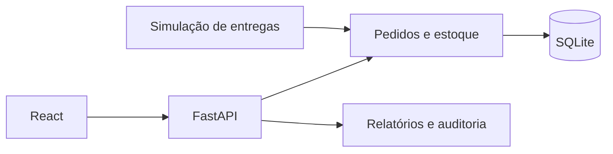

# Arquitetura observada

Python 3.13, FastAPI, Pydantic, SQLAlchemy, SQLite, React, JavaScript/JSX, Vite, React Router e Recharts. Ferramentas de distribuição Windows já estão no projeto.

Rastreamento é uma simulação, sem GPS ou integração com transportadoras. A fixture contém contas e credenciais demonstrativas, não deve ser usada em produção. O pacote não contém o banco operacional, sessões ou backups da instalação original.

O diagrama resume relações encontradas no código; não representa uma implantação em produção. Serviços externos opcionais não foram ativados nesta preparação.
